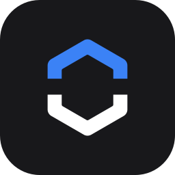
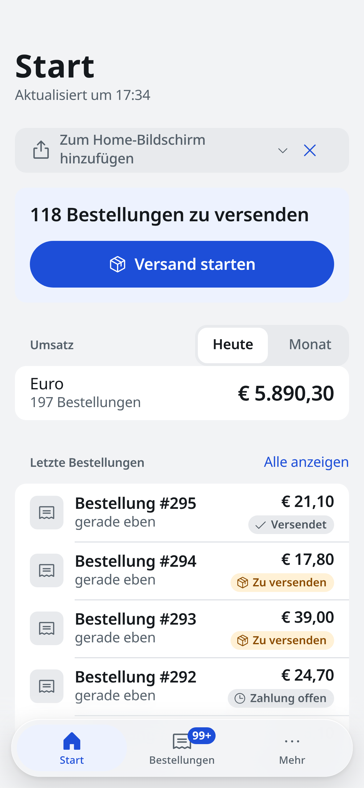
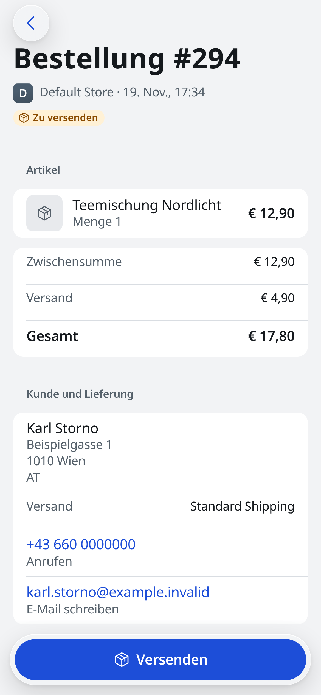
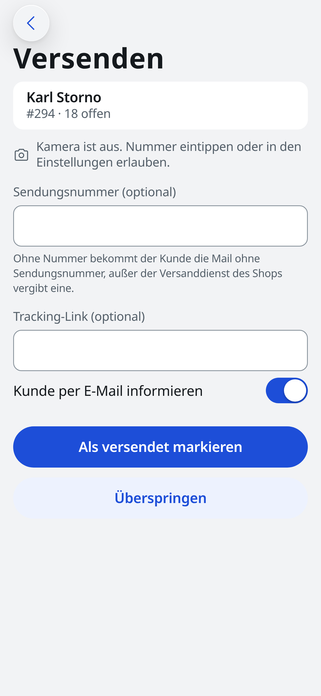

# Medusify

An installable web app for Medusa v2 shops. It shows orders and revenue, creates shipments with a tracking number
(camera scan or typing), handles the rest of an order (capture, refund, cancel, returns, delivered), and sends a push
notification to your phone when an order comes in, is canceled or has a return request. A Medusa plugin hosts
the app at `/medusify` of your own backend. There is no central server and no third-party account.

<p>
  
  
  
</p>

The screenshots show demo data from the dev shop in this repository. The interface is available in German and English
and follows the phone's language.

## Install

Requirements: Medusa 2.22.x, Node 22.22 or newer, Postgres.

```bash
npm install medusify
```

Create a VAPID key pair once per merchant. The same pair goes into every shop you want to watch:

```bash
npx web-push generate-vapid-keys
```

Add the plugin to `medusa-config.ts` of the shop:

```ts
plugins: [
  {
    resolve: "medusify",
    options: {
      vapid: {
        publicKey: process.env.MEDUSIFY_VAPID_PUBLIC_KEY,
        privateKey: process.env.MEDUSIFY_VAPID_PRIVATE_KEY,
        subject: process.env.MEDUSIFY_VAPID_SUBJECT, // "mailto:you@example.com" or an https:// URL
      },
      storeLabel: "My Shop", // shown in the push title
      locale: "en",          // language of the push texts: "de" (default) or "en"
    },
  },
],
```

Set the three `MEDUSIFY_VAPID_*` variables in the shop's environment, run `npx medusa db:migrate` (it creates one table,
`medusify_push_subscription`) and restart the backend. All options, the admin routes and the dashboard numbers are
described in [`plugin/README.md`](plugin/README.md).

## Use it on the iPhone

1. Open `https://<your-backend>/medusify/` in Safari and sign in with your normal Medusa admin account. Medusa's built-in
   MFA works.
2. Tap Share, then "Add to Home Screen", and open the app from the home screen.
3. In the installed app, open the More tab and turn on notifications.

To watch a second shop, add it in the app. The second shop has to list the app's origin in `ADMIN_CORS` and `AUTH_CORS`
(see "Several shops, one app" in the plugin README).

## What you can do with an order

Open an order and the actions that fit its state are listed under "Manage". Each one appears only while it makes sense
and only if your role may do it.

- **Capture** a payment that is authorized, or **mark as paid** when the money arrived another way.
- **Refund**, in full or in part. You type the amount, the app rejects more than what is still refundable before it
  asks the shop, and only a second tap on a red button sends it. The sheet before it shows amount, currency and shop. If the
  shop does not answer, the app does not send it a second time until it has read the order again.
- **Accept a return**: choose items and quantities, confirm the receipt, and refund right away if you want.
- **Cancel** an order. Medusa releases an authorized payment and refunds a captured one. The app asks for the refund right
  as well in that case. Medusa's own admin in the desktop browser does not, unless you set the plugin option
  `strictCancelRefund` (see "Order actions and rights" in the plugin README).
- **Mark a shipment as delivered**.
- **Call or write to the customer** with one tap on the phone number or the email address.
- **Swipe an order row to the left** to ship it or mark it as paid. The swipe opens the order with the confirmation; nothing
  happens before you confirm. Pull the list down to refresh. Every action is also on the order page.

The number on the app icon is the sum of the orders to ship in all your shops. It updates when you open the app and on
every push. Where the phone or browser has no Badging API, there is no number. In More you can switch the pushes for
cancellations and return requests on or off, per shop on this device.

## Limits

- On iOS, web push only works in the installed app, not in a Safari tab. The notification sound is the system default.
  Web push cannot play a custom sound.
- The installed app has its own storage, so you may have to sign in again there.
- Sign-in with Google (if your shop offers it) works for the shop that serves the app. It is not verified in the
  installed iOS app. Password with MFA is the tested path.
- Not verified on a real iPhone: the camera scan, the real push service, safe-area and status bar behavior. The list is
  in [`docs/SECURITY.md`](docs/SECURITY.md) and [`docs/DESIGN.md`](docs/DESIGN.md).
- There is no push for a failed payment, because Medusa 2.22 fires no event for it.
- Two shops with the same `storeLabel` cannot be told apart by a push. The icon number then waits for the next time you
  open the app. Give each shop its own label (plugin option `storeLabel`).
- If your admin host sits behind Cloudflare Access or a similar proxy, read the section on it in the plugin README.

## Security

The app keeps no order or customer data on the device, removes its push subscriptions before it signs out, and is served
with a Content-Security-Policy. The session model, what is stored where, and what was and was not measured are in
[`docs/SECURITY.md`](docs/SECURITY.md). Report vulnerabilities as described in [`SECURITY.md`](SECURITY.md).

## Repository layout

- [`plugin/`](plugin) the Medusa plugin (npm package `medusify`), includes the built app in `pwa-dist/`
- [`pwa/`](pwa) source of the app (React, Vite, TypeScript)
- [`dev-shop/`](dev-shop) a local Medusa shop with demo data for development and the end-to-end tests
- [`docs/`](docs) design notes, security model, screenshots

## Contributing

Bug reports and pull requests are welcome. [`CONTRIBUTING.md`](CONTRIBUTING.md) explains how to start the dev shop and
run the tests.

## License

[MIT](LICENSE)
